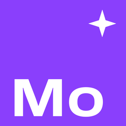
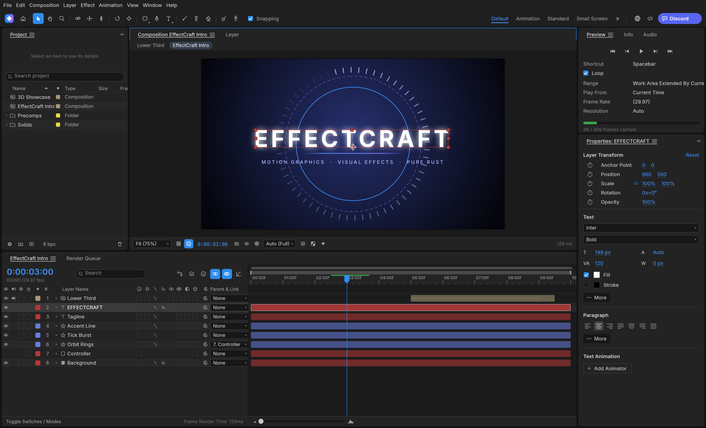
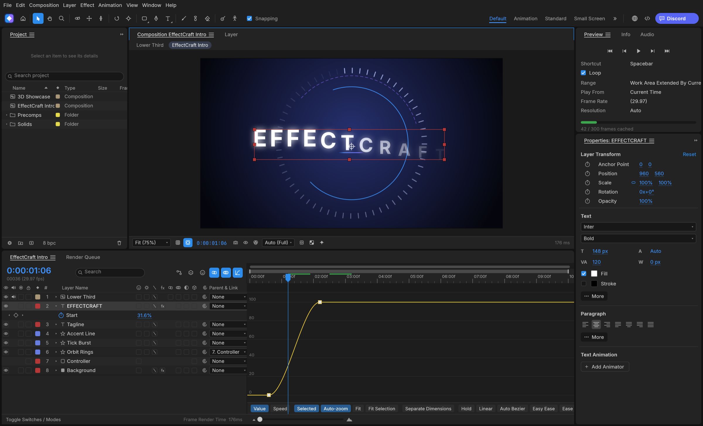
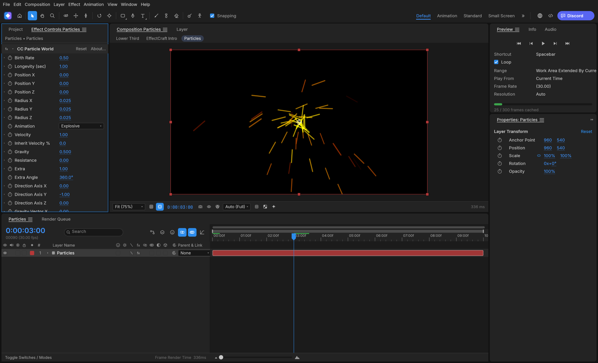
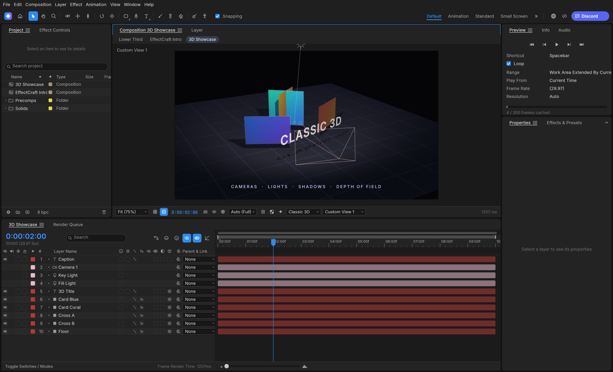

<p align="center">
  <picture>
    <source media="(prefers-color-scheme: dark)" srcset="docs/brand/oracle-logo-white.svg">
    
  </picture>
</p>

<p align="center">
  
</p>

<h1 align="center">Oracle Motion</h1>

<p align="center">
  <b>Motion graphics and visual effects; an open-source, professional motion graphics and visual effects studio, built in pure Rust.</b>
</p>

<p align="center">
  A free, open-source compositor: compositions, layers,
  keyframes, 306 effects, layer styles, expressions, 3D cameras and lights, and a render queue, native on macOS,
  Windows and Linux, and in the browser. Young, moving fast, and already usable.
</p>

<p align="center">
  
  
  
  <br>
</p>

<p align="center">
  <a href="https://github.com/Marvingxx/oracle-motion/releases/latest"><b>Download Oracle Motion</b></a> ·
  <a href="https://github.com/Marvingxx/oracle-suite">Oracle Suite</a>
</p>


<br>

<p align="center">
  
</p>


<p align="center">
  <a href="#what-oracle-motion-is">What it is</a> ·
  <a href="#animate">Animate</a> ·
  <a href="#effects">Effects</a> ·
  <a href="#3d">3D</a> ·
  <a href="#export">Export</a> ·
  <a href="#built-for-agents">Agents</a> ·
  <a href="#get-started">Get started</a> ·
  <a href="#where-it-stands">Status</a> ·
  <a href="#how-its-made">How it's made</a> ·
  <a href="#downloads">Downloads</a> ·
  <a href="#the-crafting-apps">The Crafting Apps</a> ·
  <a href="#license-and-credits">License</a>
</p>

## What Oracle Motion is

Oracle Motion is for animated titles, motion graphics and compositing work: the kind of thing
motion designers and VFX artists need. You build a composition out of layers (solids, shapes,
text, footage, other compositions), animate their properties with keyframes, stack effects on
them and render the result.

The interface feels natural and responsive, with dedicated panels (Project, Composition, Timeline,
Layer, Footage, Effect Controls, Tools, Preview, Effects & Presets, Audio, Info, Paragraph,
Character, Align, Progress, Render Queue) and standard motion graphics shortcuts, going further in
a few places where it matters to us:

- **Lottie import and export built in**, so animations can go straight to the web and apps
  without a plugin.
- **A project file you can read.** Projects are versioned JSON (`.ecproj`), so they diff cleanly
  in version control.
- **Everything is scriptable.** Every menu item, timeline drag and property edit goes through one
  command registry, so the same actions are reachable from a command line, a JSON control
  channel and an MCP server for agents.
- **No FFmpeg.** Video and audio decoding and encoding are pure Rust: FilmCraft's codecs and
  Oracle Motion's own VP9, AV1, HEVC and Opus encoders.

## Animate

The panels, menus and shortcuts follow standard motion design conventions:
Project, Composition, Timeline, Effect Controls, Properties, Effects & Presets, Character,
Paragraph, Align, Info, Preview, Audio and the Render Queue, docked the way you expect. Drag
footage, comps and effects between them: onto the comp viewer, where they land under the pointer,
or into the Timeline, between layers and at the time you point to.

- **Layers of every kind:** solids, shapes, text, footage, nested compositions, nulls,
  adjustment layers, cameras and lights; parenting, track mattes, all 38 blend modes, motion blur.
- **Keyframes that behave the same:** linear, Bezier, hold, auto and continuous Bezier, roving
  keys, Easy Ease (F9), Keyframe Velocity and Interpolation dialogs, copy and paste at the current
  time, and a **Graph Editor** with value and speed graphs and draggable handles.
- **Time:** time remapping, time stretch, time-reverse, freeze frame, work area, markers, exact
  frame-accurate timing at every frame rate including 29.97 drop-frame.
- **Shapes and masks:** shape layers with trim paths, repeaters, round corners, offset, zig zag,
  twist, wiggle, merge paths and gradient strokes; masks drawn with the pen tool, with modes,
  feather, expansion and vertex editing in the viewer.
- **Text:** point and paragraph text with real shaping in any font installed on your machine, the
  Character and Paragraph panels, and text animators with range selectors.
- **Expressions:** JavaScript with the standard motion expressions model (`wiggle`, `loopOut`,
  `thisComp.layer("…")`, vector maths on arrays), an inline editor and the pick-whip.
- **Timeline like you know it:** twirl layers open to Transform, masks, effects and the rest; drag
  rows to reorder layers; rename with Enter or a double-click; the property shortcuts (A, P, S,
  R, T, M, F, E, L, U and their double presses AA, PP, SS, RR, TT, MM, FF, EE, LL, UU), Shift to
  add properties, Alt+Shift+A/P/S/R/T to key the current time, Ctrl+` to twirl selected layers.
- **Puppet tools:** Position, Advanced, Bend, Starch and Overlap pins on a mesh built from the
  layer, real-time pin recording, rotate/scale handles, pins driven by (or carrying) nulls for
  rigging, and follow-through for hair and cloth.

<p align="center">
  
</p>

## Effects

306 built-in effects across its categories, each with its parameter names, order and
defaults: blur and sharpen, channel, color correction (Curves, Levels, Hue/Saturation, a full
color-grading panel…), distort (Warp, Bulge, Turbulent Displace, CC Power Pin…), generate (Fractal Noise,
Gradient Ramp, Stroke, Write-on, Audio Spectrum…), keying, matte, noise and grain, perspective,
**simulation** (CC Particle World, CC Rainfall, Shatter, Card Dance, Caustics, Wave World…),
stylize (Glow, CC Glass…), **time** (Echo, Posterize Time, Timewarp, Time Displacement…),
**audio** (Reverb, Parametric EQ, Delay, Stereo Mixer…), text, transitions, utility and expression
controls. All nine **Layer Styles** (Drop Shadow, Inner/Outer Glow, Bevel and Emboss, Satin,
overlays, Stroke) with Global Light. Preview plays audio in sync, with meters and waveforms.

<p align="center">
  
</p>

## 3D

Classic 3D compositing: 3D layers with orientation and material options,
one- and two-node **cameras** with depth of field, **lights** (parallel, spot, point, ambient)
with soft ray-traced shadows, layers that intersect correctly, orbit, pan and dolly camera
tools, and Front, Top, Left and Custom views.

<p align="center">
  
</p>

## Export

A dedicated Render Queue, with Render Settings and Output Modules: **H.264** MP4 and
**ProRes** MOV (Proxy to 4444 XQ with alpha) with audio, **HEVC** (Main / Main 10) and **AV1**
MP4, **WebM** (VP9 with inter frames and alpha, or AV1; Opus audio), PNG, JPEG, TIFF and 32-bit EXR sequences, animated GIF and WAV/AIFF. Field
rendering with 3:2 pulldown, effect/solo/guide/depth overrides, crop, region of interest and
resize, Render Settings and Output Module templates with defaults, post-render actions, storage
overflow and render logs. The same queue runs from the command line. Every encoder is pure
Rust (FilmCraft's H.264, ProRes and AAC; Oracle Motion's own VP9, AV1, HEVC and Opus); there is no
FFmpeg inside.

**Lottie** goes both ways: File ▸ Export ▸ Lottie JSON… writes a composition (precomps, shape,
solid, image, text and null layers, eased and spatial keyframes, masks, track mattes, blend
modes, time remapping, optionally expressions) as `.json` or `.lottie`, and lists anything Lottie
cannot express; File ▸ Import ▸ Lottie… opens one as a new composition.

<p align="center">
  
</p>

## Built for agents

Everything you can do from a menu is a command with an id, and agents can reach every one of
them:

- **MCP server:** `oracle-motion-cli mcp` speaks the Model Context Protocol over stdio, headless
  or bridged to the running app (`--bridge 9877`). Tools cover commands, the project and property
  tree, keyframes and rendered frames. This repository ships a ready [`.mcp.json`](.mcp.json).
- **Command line:** one-shot calls with JSON output, for example
  `oracle-motion-cli set Main '#1' transform/position '[100,360]' --time 0 main.ecproj --save`
  or `oracle-motion-cli render --comp Main --out main.mp4`, or
  `oracle-motion-cli exec file.exportLottie '{"comp":"Main","path":"main.json"}' main.ecproj`.
- **Control channel:** `oracle-motion --control 9877` accepts JSON lines to run commands, inspect
  and click any widget by its automation id, and take screenshots.

See [docs/agents.md](docs/agents.md) and [docs/control-protocol.md](docs/control-protocol.md).

## Get started

Installers for each version are on the [Releases](https://github.com/Marvingxx/oracle-motion/releases)
page: a universal macOS app; Windows MSIs and portable zips for x64, x86 and ARM64; Linux
AppImage, Flatpak, deb, rpm and tar.gz for x86_64 and aarch64, plus a riscv64 tar.gz; a FreeBSD x86_64 tarball; and the
web build. [Downloads](#downloads) lists every file. The Windows ARM64 build runs natively on
Windows on ARM, without x64 emulation. CI installs that MSI on Windows 11 ARM64 hardware, checks
both programs are ARM64 and runs the command-line tool there, but it doesn't open the app's window
or run the test suite natively on ARM64 yet, so please report anything that behaves differently.

On Gentoo, the community [::snakebyte overlay](https://github.com/switch87/snakebyte-overlay) packages
the Linux release as `media-video/oracle-motion-bin` (not maintained by the Oracle Motion team):

```sh
eselect repository add snakebyte git https://github.com/switch87/snakebyte-overlay.git
emaint sync -r snakebyte
echo 'media-video/oracle-motion-bin ~amd64' >> /etc/portage/package.accept_keywords/oracle-motion
emerge --ask media-video/oracle-motion-bin
```

To build it yourself you need [Rust](https://rustup.rs/) 1.95 or newer.

```sh
git clone https://github.com/Marvingxx/oracle-motion
cd oracle-motion
cargo run --release -p oracle-motion          # the app (add `-- --demo` to open the demo project)
cargo run --release -p oracle-motion-cli -- render --out intro.mp4    # render the demo headless
cargo xtask web --serve 8765                # the browser build on http://127.0.0.1:8765/ (docs/web.md)
```

New to it? [docs/footage.md](docs/footage.md) covers importing footage and image sequences and
Interpret Footage.

To work on it: `cargo test --workspace`, and `cargo xtask ci` before every commit (format, lints,
tests, layering, asset attribution and the WebAssembly build). See [CONTRIBUTING.md](CONTRIBUTING.md),
[docs/architecture.md](docs/architecture.md) and [docs/testing.md](docs/testing.md).

## Where it stands

Oracle Motion is young: its first commit was on 1 October 2026. A comprehensive feature set
exists, including 306 effects, but breadth is not the same as full maturity across every edge
case. Today it's a good place to try things and to tell us what breaks. It isn't yet recommended
for production client work. In particular:

- **Native project format.** Projects are saved as `.ecproj`, readable versioned JSON. Proprietary
  project formats and After Effects SDK plug-ins are not supported.
- **Fidelity is still being refined.** Automated rendering tests currently focus on small
  compositions, so please report visual discrepancies or unexpected behaviour.
- **macOS is the most tested platform.** Linux and Windows users have hit basic interaction
  bugs, which we're fixing first.
- **The trained models are new.** Roto Brush can use MobileSAM (an optional 40 MB download in
  Settings ▸ Roto Brush) and face tracking can use Google's MediaPipe Face Landmarker (an optional
  3.8 MB download in Settings ▸ Face Tracking). Both are actively undergoing evaluation and tuning.

Oracle Motion is in **alpha**: about 91% of the features tracked in
[docs/target-app-parity.md](docs/target-app-parity.md) exist, and we estimate it is about 45% of the
way to being ready for full professional production work. The [ROADMAP](ROADMAP.md) has the plan,
[docs/target-app-parity.md](docs/target-app-parity.md) the measurement and [docs/gaps.md](docs/gaps.md)
every known shortfall. The web build ([docs/web.md](docs/web.md)) runs the full app in the browser.
[Bug reports](https://github.com/Marvingxx/oracle-motion/issues) are the most useful thing you can
send us right now.

## How it's made

- **Engine first.** A stack of small crates with strict layering. The interface (egui) sits on
  top and nothing underneath depends on it.
- **Clean room.** We work from public documentation and observable behavior, never
  from proprietary files, icons, presets or code. No code is copied from GPL projects. The full rules
  are in [AGENTS.md](AGENTS.md).
- **Private by default.** No telemetry, and no network access unless you ask for it.
- **One family.** Oracle Motion shares its time model and text engine design with FilmCraft, and
  gets its video and audio codecs from it.

## Downloads

**New to Oracle Motion?** Download it from the [Oracle Motion releases on GitHub](https://github.com/Marvingxx/oracle-motion). That's the easiest way to install it.

**Want a specific build or format?** On GitHub, the [latest release](https://github.com/Marvingxx/oracle-motion/releases/latest) has every build listed below, and [all releases](https://github.com/Marvingxx/oracle-motion/releases) has earlier versions and their notes. `<ver>` in the file names is the version number, and `SHA256SUMS.txt` lists a checksum for every file.

### Windows

| Build | Installer | Portable |
|---|---|---|
| x64 (64-bit Intel/AMD) | `oracle-motion-<ver>-windows-x64.msi` | `oracle-motion-<ver>-windows-x64-portable.zip` |
| arm64 (Snapdragon and other ARM PCs) | `oracle-motion-<ver>-windows-arm64.msi` | `oracle-motion-<ver>-windows-arm64-portable.zip` |
| x86 (32-bit) | `oracle-motion-<ver>-windows-x86.msi` | `oracle-motion-<ver>-windows-x86-portable.zip` |

Installers and executables are code-signed. The installer asks where to install Oracle Motion
(Program Files by default), and later versions install into the same folder. To install silently
into a folder of your choice: `msiexec /i oracle-motion-<ver>-windows-x64.msi /qn INSTALLFOLDER="D:\Apps\Oracle Motion"`.

### macOS

| Build | File | Notes |
|---|---|---|
| App, universal (Apple silicon + Intel) | `oracle-motion-<ver>-macos-universal.dmg` | Signed and notarized |
| Command-line tool, universal | `oracle-motion-cli-<ver>-macos-universal.zip` | Signed and notarized |

### Linux

| Format | x86_64 | aarch64 (ARM64) | Notes |
|---|---|---|---|
| AppImage | `oracle-motion-<ver>-linux-x86_64.AppImage` | `oracle-motion-<ver>-linux-aarch64.AppImage` | Runs anywhere; updates itself with [AppImageUpdate](https://github.com/AppImageCommunity/AppImageUpdate) (`.zsync` files) |
| Flatpak | `oracle-motion-<ver>-linux-x86_64.flatpak` | `oracle-motion-<ver>-linux-aarch64.flatpak` | Sandboxed; `flatpak install --user <file>` |
| Debian/Ubuntu | `oracle-motion-<ver>-linux-x86_64.deb` | `oracle-motion-<ver>-linux-aarch64.deb` | |
| Fedora/RHEL/openSUSE | `oracle-motion-<ver>-linux-x86_64.rpm` | `oracle-motion-<ver>-linux-aarch64.rpm` | |
| Tarball | `oracle-motion-<ver>-linux-x86_64.tar.gz` | `oracle-motion-<ver>-linux-aarch64.tar.gz` | Unpack anywhere |

RISC-V 64-bit: `oracle-motion-<ver>-linux-riscv64.tar.gz` (tarball only; needs glibc 2.39+, e.g. Ubuntu 24.04+ or Debian 13+).

**File drag-and-drop on Linux:** The current eframe/winit 0.30 native Wayland backend does not
deliver file-hover or file-drop events. On Hyprland and other native Wayland sessions, use
**File ▸ Import ▸ File…** (which accepts multiple files), or start Oracle Motion via XWayland if
XWayland is installed and `DISPLAY` is set:

```sh
env -u WAYLAND_DISPLAY oracle-motion
```

When the backend delivers events (X11/XWayland, Windows and macOS), dropping media anywhere
in the window imports it, and a drop-target hint appears while hovering. On native Wayland the
app cannot detect an attempt that generates no event; it shows a startup notice with the
File ▸ Import fallback instead.

### FreeBSD

| Build | File |
|---|---|
| x86_64 | `oracle-motion-<ver>-freebsd-x86_64.tar.gz` |

### Web (WebAssembly)

| Build | File | Notes |
|---|---|---|
| Static site | `oracle-motion-web-<ver>.zip` | Runs in a modern browser; host it on any static server |

## The Oracle suite

Oracle Motion is part of **Oracle**, a personal creative suite, free and local:

| App | What it's for | Code |
|---|---|---|
| **Oracle Suite** | Launcher: installs, updates and opens the apps; the shared asset library | [oracle-suite](https://github.com/Marvingxx/oracle-suite) |
| **Oracle Edit** | Image editing | [oracle-edit](https://github.com/Marvingxx/oracle-edit) |
| **Oracle Vector** | Vector illustration | [oracle-vector](https://github.com/Marvingxx/oracle-vector) |
| **Oracle Brand Kit** · **Oracle Mockup Studio** | Brand identities and client deliveries · 2D mockups | [oracle-brand](https://github.com/Marvingxx/oracle-brand) |
| **Oracle Brand Guide** | Brand guidelines and page layout | [oracle-guide](https://github.com/Marvingxx/oracle-guide) |
| **Oracle Motion** | Motion graphics and compositing | [oracle-motion](https://github.com/Marvingxx/oracle-motion) |

Oracle Motion started as a fork of [EffectCraft](https://github.com/storytold/effectcraft) by the ArtCraft
team (MIT OR Apache-2.0), taken on 22 October 2026 and developed separately since. It is not
affiliated with or endorsed by ArtCraft.

## License and credits

Oracle Motion is dual-licensed under [MIT](LICENSE-MIT) or [Apache-2.0](LICENSE-APACHE), at your option.
Copyright (c) 2026 ArtCraft Team and the Oracle Motion contributors. Required notices are in [NOTICE](NOTICE).

Bundled fonts, icons, images and other assets keep their own open licenses; each one is listed
with its author, source and license in [ATTRIBUTION.md](ATTRIBUTION.md).

The Oracle name and logo in [`docs/brand/`](docs/brand/) are the project's brand marks and are not
covered by this license (see [`docs/brand/LICENSE-brand.txt`](docs/brand/LICENSE-brand.txt)). The
ArtCraft marks of the original project have been removed, as its brand license asks of forks.


